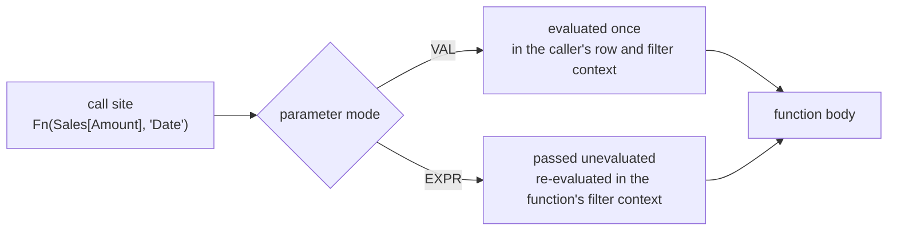

# Authoring DAX user-defined functions

How to write the signature and body of a UDF: the parameter type system, evaluation modes, type
checks, testing and the restrictions. When a UDF earns its place, naming and documentation:
[`organize-semantic-model/references/udfs.md`](../../organize-semantic-model/references/udfs.md).
Formatting UDFs and the load traps when one UDF calls another:
[number-formatting.md](number-formatting.md#the-udf-write-the-formatting-convention-once).

Adapted from upstream's `dax/references/udf-authoring.md` (26.45), checked against the Microsoft
Learn page on 2026-11-13: optional parameters are supported, and rename fix-up works.



## Signature

```dax
DEFINE
    /// Adds tax to an amount
    /// @param {NUMERIC} amount - the pre-tax value
    /// @param {DOUBLE} [rate] - the tax rate, 0.1 when omitted
    FUNCTION Finance.AddTax = ( amount : NUMERIC, rate : DOUBLE = 0.1 ) =>
        amount * ( 1 + rate )
```

In a PBIP the same function sits in `definition/functions.tmdl`. A dotted name is quoted in TMDL:

```tmdl
/// Adds tax to an amount
function 'Finance.AddTax' = ( amount : NUMERIC, rate : DOUBLE = 0.1 ) => amount * ( 1 + rate )
```

TMDL view in Desktop wraps the same text in `createOrReplace`; that is a script verb, not file
content.

A parameter is `name : [TYPE] [SUBTYPE] [MODE] [= default]`. Every part is optional; a bare name
is `ANYVAL VAL`, and a default makes the parameter optional.

```yaml
types:
  value types (evaluated before the call, implicit type casting):
    ANYVAL: scalar or table, the default
    SCALAR: scalar only
    TABLE:  table only
  expression types (always EXPR, no casting):
    ANYREF: any reference
    COLUMNREF, TABLEREF, MEASUREREF, CALENDARREF: a reference of that kind
scalar subtypes (imply SCALAR):
  NUMERIC:  any number (Int64, Decimal, Double)
  INT64:    whole number; rounds 3.5 to 4 and casts "5" to 5
  DECIMAL:  fixed precision (Currency)
  DOUBLE:   floating point
  STRING, DATETIME, BOOLEAN
  VARIANT:  any scalar
modes:
  VAL:  eager, evaluated once at the call site, in the caller's row and filter context (default for value types)
  EXPR: lazy, evaluated inside the body, in whatever filter context the body sets; no row context from the caller
defaults:
  "= <expr>":  the caller may omit the argument, or leave it empty: Fn ( 1, , 3 )
  arity:       set by the rightmost required parameter
  scope:       a default sees names visible where the UDF is defined, never another optional parameter
shorthand:
  "x : INT64":       SCALAR INT64 VAL
  "t : TABLE EXPR":  lazy table
```

## VAL versus EXPR

The mode decides which filter context an argument sees. With `VAL`, a `CALCULATE` inside the body
cannot change the argument: it is already a value. With `EXPR`, the body can wrap the argument in
`CALCULATE` or `CALCULATETABLE` and change its context.

```dax
DEFINE
    /// The rows of t under the caller's filters; ALL ( 'Date' ) has no effect
    FUNCTION CountEager = ( t : TABLE VAL ) =>
        COUNTROWS ( CALCULATETABLE ( t, ALL ( 'Date' ) ) )

    /// The rows of t across every date
    FUNCTION CountAllDates = ( t : TABLE EXPR ) =>
        COUNTROWS ( CALCULATETABLE ( t, ALL ( 'Date' ) ) )
```

Use `VAL` for plain inputs such as amounts, rates and keys. Use `EXPR` when the function must
evaluate the argument under a different filter context, for example time intelligence that takes a
measure. A measure meant to be re-evaluated per period needs `EXPR` (or `MEASUREREF`); passed as
`VAL`, it arrives as one fixed number. Pass a variable to an `EXPR` parameter, never a nested
`VAR … RETURN` block ([flat-vars.md](flat-vars.md)).

## Type checks

A parameter without a subtype can take several types; branch on the type at run time. For an `EXPR`
parameter the check runs where the body references it, not at the call.

```yaml
numeric:   ISNUMERIC, ISNUMBER
whole:     ISINT64, ISINTEGER
decimal:   ISDECIMAL, ISCURRENCY
double:    ISDOUBLE
text:      ISSTRING, ISTEXT
boolean:   ISBOOLEAN, ISLOGICAL
date:      ISDATETIME
reference: TABLEOF (the table behind a column, measure or calendar), NAMEOF (its name as text)
```

```dax
DEFINE
    /// The currency name, from a whole-number key or a text code
    FUNCTION Currency.Name = ( currency ) =>
        IF (
            ISINT64 ( currency ),
            LOOKUPVALUE ( Currencies[Currency], Currencies[CurrencyKey], currency ),
            LOOKUPVALUE ( Currencies[Currency], Currencies[Code], currency )
        )
```

Fail loudly on input the function cannot handle, rather than returning a BLANK that hides the
mistake:

```dax
DEFINE
    FUNCTION Double = ( input ) =>
        IF ( ISNUMERIC ( input ), input * 2, ERROR ( "Double: input must be numeric" ) )
```

## Calling a UDF

A UDF is called like any DAX function, from measures, calculated columns, calculation items,
visual calculations and other UDFs.

```dax
Total With Tax =

    Finance.AddTax ( [Total Sales], 0.21 )
```

In a calculated column, wrap the result in `CONVERT` when the column must keep one data type, since
the return type is not declared:

```dax
Sales Tax =

    CONVERT ( Finance.AddTax ( Sales[Amount], 0.21 ), CURRENCY )
```

A function can call another defined before or after it in the same model (read the load traps in
[number-formatting.md](number-formatting.md) first). Recursion and mutual recursion are not
allowed.

## Pattern: flexible key with a lookup

```dax
DEFINE
    /// amount in the target currency, by key or code, at the average or end rate
    FUNCTION Currency.Convert = ( amount : DECIMAL, target, useAverage : BOOLEAN = TRUE ) =>
        // A whole number is already the key; anything else is a code to look up
        VAR __Key =
            IF (
                ISINT64 ( target ),
                target,
                LOOKUPVALUE ( Currencies[CurrencyKey], Currencies[Code], target )
            )
        // The rate for that key, average or end of period
        VAR __Rate =
            IF (
                useAverage,
                LOOKUPVALUE ( Rates[AvgRate], Rates[CurrencyKey], __Key ),
                LOOKUPVALUE ( Rates[EndRate], Rates[CurrencyKey], __Key )
            )
        VAR __Result = amount * __Rate
        RETURN
            __Result
```

## Testing

Define the function in the query and evaluate it against fixed inputs before saving it to the
model. Run the query against Desktop with `pbi-desktop:connect-pbid`, or against a deployed model
with `te query` (see the [`te-cli` skill](../../../../tabular-editor/skills/te-cli/)):

```dax
DEFINE
    FUNCTION Finance.AddTax = ( amount : NUMERIC, rate : DOUBLE = 0.1 ) => amount * ( 1 + rate )
EVALUATE
{ Finance.AddTax ( 100, 0.21 ), Finance.AddTax ( 0, 0.21 ), Finance.AddTax ( BLANK (), 0.21 ), Finance.AddTax ( 100 ) }
```

Include an edge case per parameter: BLANK, zero, a wrong type, and the default omitted. For `EXPR`
parameters, evaluate inside `SUMMARIZECOLUMNS` over the dimension the function changes, so the
context change is visible in the result. After saving, `EVALUATE INFO.USERDEFINEDFUNCTIONS()` and
read `ErrorMessage`.

## Restrictions to design around

```yaml
no overloading:   one function per name; branch on type instead
no recursion:     direct or mutual
no return type:   the result type follows the body; CONVERT where it matters
no enum returns:  a UDF cannot feed a built-in parameter that takes an enum
not in models:    without tables; display folders, hide/unhide and translations do not apply
OLS:              does not carry to a function that references a secured object
qualify columns:  an unqualified name reads as a measure, so fix-up and dependencies miss it
parser noise:     a column passed to an EXPR parameter can show a red underline that is not an error
```

Check the [Microsoft Learn page](https://learn.microsoft.com/en-us/dax/best-practices/dax-user-defined-functions)
before relying on a restriction; the list has shrunk since the September 2025 preview, and UDFs
went GA in June 2026.
